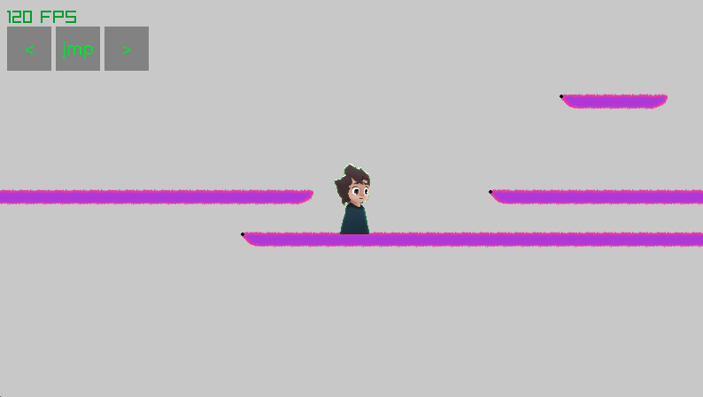

# AnimeTower

AnimeTower game on raylib with custom physics.
C++23 for fancy stuff.



## notes section

* at - prefix, as AnimeTower (ex. atPhysics.h)
* lwp - lightweight physics

# Get source
```bash
# --recurse-submodules for raylib
git clone --recurse-submodules <repo-url>
```
# Requirements

- CMake
- Visual Studio 2022+ (MSVC)
- for comfy vscode: `ms-vscode.cpptools-extension-pack`

# Distribution (easy way to build and run)

* run `dist.bat`
* it creates:
```
./
└── distribution/        
    ├── AnimeTower/
    |    ├── resource/   
    |    └── AnimeTower.exe                 # Desired .exe
    └── AnimeTower_YYYY-MM-DD_HH-MM.zip     # .zip of AnimeTower folder
```
* might return an error (known issue):
  * Microsoft Defender scans the freshly built `.exe` and blocks archiving
  * `AnimeTower.exe` works fine, only `.zip` created without `AnimeTower.exe`
  * to fix(`YOUR RISKS`, if you need): exclude project folder from Defender scanning (run PowerShell **as Admin**):
    ```powershell
    Add-MpPreference -ExclusionPath "D:\useful\!projects_new\AnimeTower"
    ``` 

# Verification before commit

`run_all.bat` sequantially `build` and `executes:
* debug: `AnimeTower`, `AnimeTower_Tests`
* release: `AnimeTower`, `AnimeTower_Tests`
* dist: `AnimeTower`


# Project structure
```
./
├── 3rdParty/raylib         # raylib (git submodule)
├── src/
│   ├── main.cpp            # AnimeTower main()
│   ├── main_Tests.cpp      # Tests main()
│   ├── CMakeLists.txt
│   └── CMakePresets.json
├── resource/               # resources
├── build/                  # build output (gitignored)
├── dist.bat                # see "Distribution" section
├── distribution/           # release output (gitignored)
└── .vscode/                # comfy vscode tasks, settings, launch config (run tests, game)
```

# Build

* NOTE `CMakeLists.txt` in `src/`, so all scripts should address it

## source of truth
* `.vscode/tasks.json` - how to build (commands right there)
* `dist.bat` - how to build dist via .bat
* `.vscode/launch.json` - where .exe lives

## overview 

presets
* **debug**
* **release**
* **dist** - Same as release. No console window.

targets
* **AnimeTower**
* **AnimeTower_Tests**

build example:
```bash
cd src
cmake --preset debug
cmake --build --preset debug --target AnimeTower
cd ..
```


# license

MIT © KachanVladislav — see [LICENSE](LICENSE)

Uses [raylib](https://github.com/raysan5/raylib) (zlib/libpng license)
